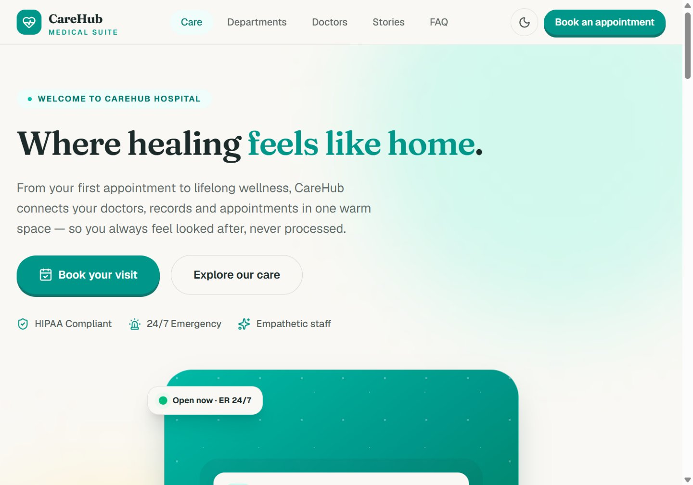

<div align="center">

# 🩺 CareHub Plus

**A hospital marketing site with a booking wizard and a portal preview — all in the browser.**


</div>

---

## ✨ Why CareHub?

Hospital sites tend to bury the things people actually need: which department to book, which doctor to see, and what happens when you arrive. CareHub puts those first. It is a marketing site with a real multi-step booking flow, a searchable department directory, doctor profiles, patient stories and an FAQ — plus a static preview of what a patient portal could look like.

There is no API and no database. The copy and listings live in `src/lib/data.ts`, and the booking wizard, contact form and portal screen all run in the browser. That makes it a clean front-end demonstration: easy to clone, easy to change, and honest about where the boundary is.

### 🧩 What's inside

- 🏥 **Departments** — a searchable list plus a page per specialty.
- 👩‍⚕️ **Doctor directory** and patient stories.
- 📅 **Booking wizard** — a multi-step appointment flow.
- ❓ **FAQ** — an accordion of common questions.
- 🧾 **Portal preview** — a static patient-portal screen.
- 🌗 **Dark mode** — follows the system preference and can be toggled; the choice is stored in `localStorage`.

---

## 📸 Screenshots



---

## 🚀 Quick start

```bash
npm install
npm run dev
```

Open http://localhost:3000.

| Command | What it does |
| --- | --- |
| `npm run dev` | Development server |
| `npm run build` | Production build |
| `npm run start` | Serve the production build |
| `npm run lint` | ESLint |

---

## 🧱 Stack

| Layer | Choice |
| --- | --- |
| Framework | Next.js 16 (App Router), React 19 |
| Language | TypeScript |
| Styling | Tailwind CSS v4 |
| Content | Local data module (`src/lib/data.ts`) |
| State | Browser `localStorage` for theme |

---

## 🗺 Pages

| Route | What it shows |
| --- | --- |
| `/` | Hero, stats, department preview, journey, testimonials |
| `/about` | Hospital story |
| `/departments` | Searchable department list, plus a page per specialty |
| `/doctors` | Doctor directory |
| `/stories` | Patient stories |
| `/faq` | Accordion of common questions |
| `/book` | Multi-step appointment wizard |
| `/contact` | Contact form |
| `/portal` | Static preview of a patient portal |

---

## 🗺 Roadmap ideas

- 🔌 Wire the booking wizard to a real API
- 🗄️ Move content from `data.ts` into a CMS or content collections
- 🔎 Search across doctors and departments from one field
- ♿ Automated axe checks for the booking flow

---

<div align="center">

A front-end demonstration of a calmer hospital experience. Built with Next.js and Tailwind.

</div>
